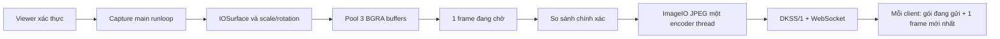

# ĐK ScreenStream

Project Theos riêng, package `com.dk.screenstream`, JPEG/WebSocket trên IPv4/cổng
5802. ĐK ViewPhone tiếp tục dùng RFB trên 5901 và web trên 5801.

Phiên bản đầu triển khai luồng xem có xác thực. **Chỉ xem** là quyền duy nhất;
server không có handler tap/swipe/keyboard và từ chối các lệnh đó. Input sẽ được
bổ sung sau khi xác minh luồng xem trên iPhone; không coi là đã triển khai.

## Cài và sử dụng

1. Cài DEB roothide bằng trình quản lý gói của iPhone hoặc `dpkg -i`.
2. Mở **Settings → ĐK ScreenStream**. Mặc định server tắt.
3. Nhấn **Sao chép mã kết nối**, bật ScreenStream, mở địa chỉ Web được hiển thị
   trên máy tính cùng LAN rồi dán mã. Mã không được lưu trong browser storage/URL.
4. Tắt bằng công tắc riêng. Cài/gỡ ScreenStream không sửa preferences, daemon,
   input hoặc tài nguyên của ViewPhone. Khi benchmark, chỉ bật một engine.

HTTP/WS yêu cầu mã kết nối nhưng không mã hóa đường truyền. Dùng LAN tin cậy hoặc
tunnel SSH; không mở cổng Internet. Khi nhập `auto`, chỉ chọn IPv4 LAN riêng đang
hoạt động; mất LAN dùng loopback. Mỗi phiên cần xác thực và hết hạn sau một giờ.
Đổi mã trong Settings ngắt các phiên, công tắc tắt/bật cũng reset recovery budget.

## Preset

| Preset | Scale | FPS mục tiêu |
|---|---:|---:|
| Low | 0.50 | 10 |
| Balanced | 0.65 | 15 |
| High | 0.75 | 20 |

JPEG quality mặc định 0.70, cạnh ảnh tối đa 1024. Scale/FPS có thể ghi đè trong
Nâng cao. Đây là cấu hình khởi đầu; không bảo đảm FPS hoặc độ trễ thực tế.

## Pipeline và bộ nhớ



Không thay gói WS đang gửi dở. Chỉ thay frame chưa bắt đầu gửi, vì vậy byte stream
không bị nối sai. Client JS cũng có một decode đang chạy và một frame chờ; bitmap
được đóng sau khi vẽ hoặc khi phiên đã đổi. Khi không còn viewer, dừng timer,
đóng queue, join encoder và trả surfaces/buffers. Stream đang chờ không tăng vô hạn.

`Common/`, `Capture/`, `Encoder/`, `Streaming/`, `Daemon/`, `Preferences/` và `Web/`
có vòng đời riêng. Supervisor mobile dùng socketpair riêng và recovery budget,
không dùng trạng thái/log của ViewPhone và không restart theo lịch để che lỗi.

## Build

Dùng workflow `.github/workflows/build-screenstream.yml` hoặc macOS/Theos roothide:

```bash
export THEOS=/path/to/roothide/theos
export THEOS_PACKAGE_SCHEME=roothide
cd screenstream
FINALPACKAGE=1 gmake clean package
python3 devkit/verify-package.py packages/com.dk.screenstream_0.1.0_iphoneos-arm64e.deb
```

Không cần Xcode trên Windows. Dependency build là roothide/Theos và SDK iOS;
không cần binary hoặc tài nguyên FarmBIOS. Source/giấy phép: [ATTRIBUTION.md](ATTRIBUTION.md).

## Kiểm thử và giới hạn

Tests kiểm tra byte protocol, queue bounded, WS malformed/masking/fragmentation,
partial writes, xác thực và cô lập client. CI macOS kiểm tra server bằng socket
thật và ImageIO JPEG round trip, sau đó build/validate DEB iOS. Những kiểm tra host
không xác minh CARenderServer/accelerator hoặc hiệu năng iPhone.

RTT hiển thị trong viewer là khứ hồi ping ứng dụng, không phải độ trễ hiển thị.
Chưa có phép đo clock-synchronized/optical nên không công bố one-way latency.
Theo dõi [tiến độ và trạng thái đo thực](../docs/SCREENSTREAM-PROGRESS.md).
